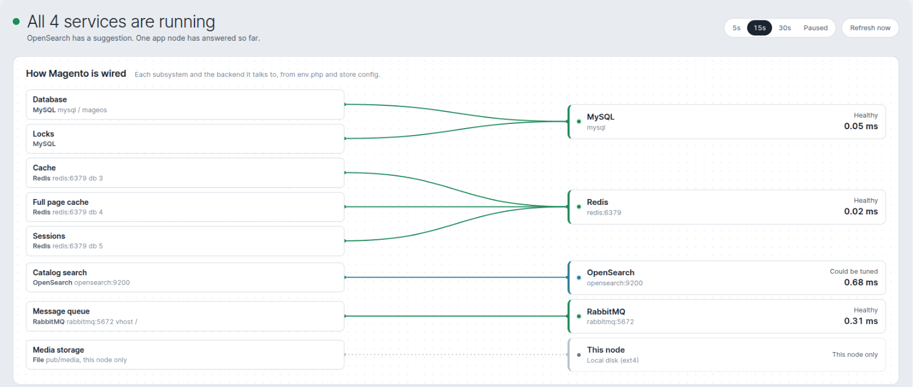
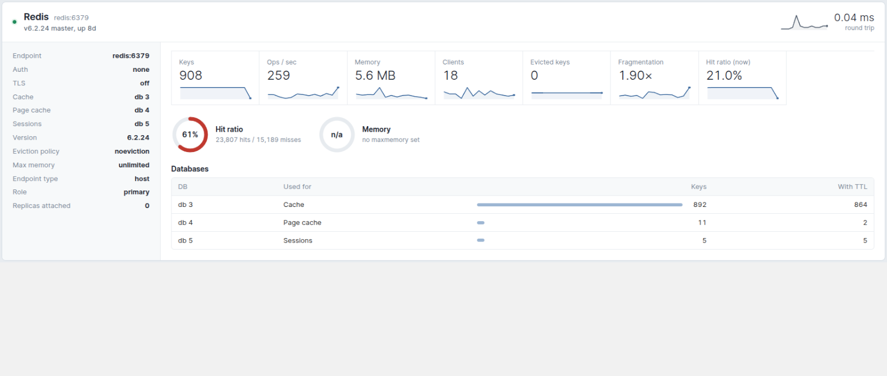
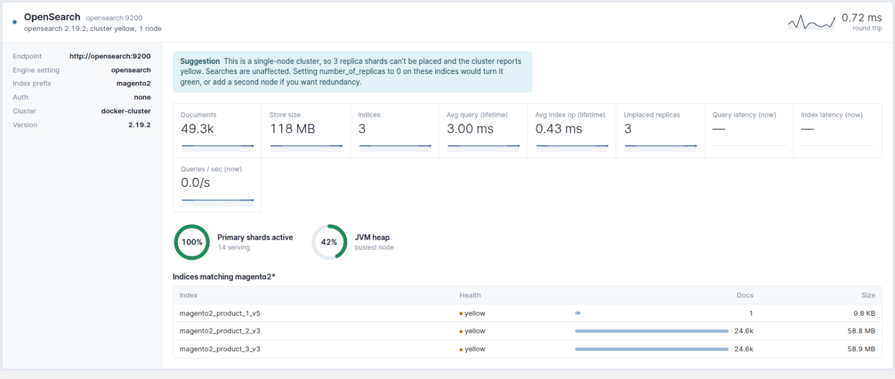
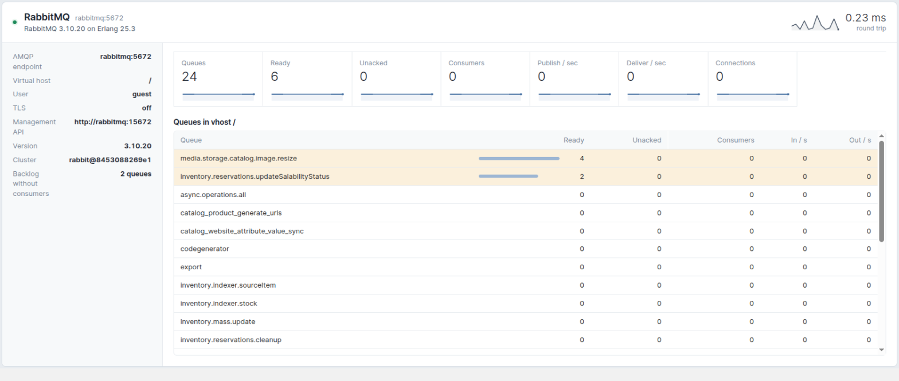

# Furan_InfraHealth

Infrastructure health for the Magento admin. See what Magento is wired to and how each backend is doing, at a glance.

<table>
  <tr>
    <td width="50%"></td>
    <td width="50%"></td>
  </tr>
  <tr>
    <td width="50%"></td>
    <td width="50%"></td>
  </tr>
</table>

**System → Tools → Infrastructure Health**, or from the command line:

```
bin/magento infrahealth:status [--json]
```

## What it checks

- **MySQL**: writer and read replicas (Adobe Commerce, Magentiz_SplitDb, Furan_ReadWriteSplit)
- **Redis**: cache, page cache and sessions
- **OpenSearch / Elasticsearch / ElasticSuite**
- **RabbitMQ**
- **App node**: PHP, OPcache and container limits
- **Storage**: local disk or shared mount (NFS, EFS, GlusterFS)

All checks are read only and nothing is stored on the server.

## Install

```
composer require furan/magento-infra-health
bin/magento module:enable Furan_InfraHealth
bin/magento setup:upgrade
```

Requires PHP 8.0+.

## Adding a check

Implement `Furan\InfraHealth\Api\ProbeInterface` and register it in your module's `di.xml`:

```xml
<type name="Furan\InfraHealth\Model\ProbeRunner">
    <arguments>
        <argument name="probes" xsi:type="array">
            <item name="varnish" xsi:type="object">Vendor\Module\Model\VarnishProbe</item>
        </argument>
    </arguments>
</type>
```

```php
public function run(): array
{
    $result = new ProbeResult('varnish', 'Varnish', 'varnish:6081');
    $result->addStat('objects', 'Objects', $objects);
    $result->addGauge('Hit ratio', $hitRatio, '', true);

    return [$result];
}
```

Wiring board rows can be added with `Furan\InfraHealth\Api\WiringProviderInterface` on `Furan\InfraHealth\Model\Wiring`.

## Configuration

Optional, in `app/etc/env.php`:

```php
'infra_health' => [
    'rabbitmq_management_url' => 'https://broker.example.com',
],
```
